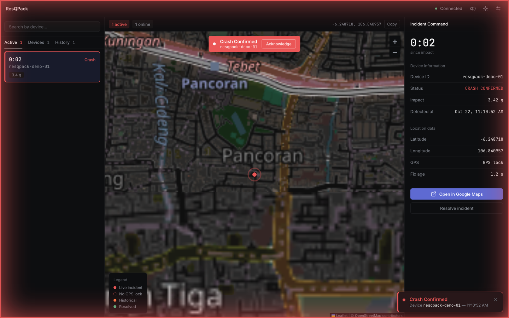
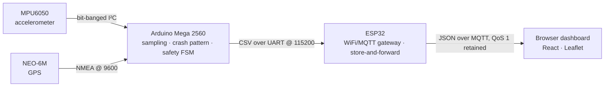
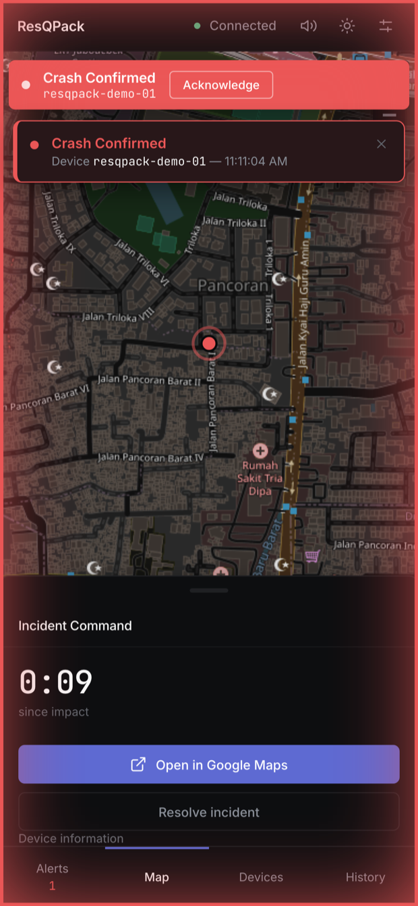

# ResQPack

A wearable crash-detection system for motorcyclists. An accelerometer pattern detector on an
Arduino Mega decides that a rider has actually crashed, gives them five seconds to cancel, and then
relays the event with GPS coordinates through an ESP32 MQTT gateway to a live browser dashboard
that anyone can watch from anywhere.


**[Open the live dashboard →](https://benedictnareswara.github.io/ResQPack/)**

The dashboard is deployed and real: it connects to the same public MQTT broker the vest publishes
to. With no vest nearby there is nothing to show, so open **Settings → Demo** and publish a test
alert to watch the full arrival path — toast, siren, map marker, incident panel and the elapsed
clock — without any hardware.



<!-- A 10-15s screen recording of an alert arriving belongs here:
      -->

## The problem

A rider who comes off alone can be unconscious thirty metres into a ditch, invisible from the road,
with nobody aware anything happened. Phone-based crash detection assumes the phone survived the
impact, has signal, and was not in a jacket pocket now lying somewhere else. ResQPack puts the
detection in the vest and the alert on somebody else's screen, so the person who can send help
finds out without the rider doing anything.

## How it works



| Tier | Owns | Why it is separate |
|---|---|---|
| Mega 2560 | Sampling, crash detection, the alert state machine, the buzzer and the cancel button | Hard-real-time work with no network stack in the way. It decides what counts as a crash, and nothing downstream second-guesses it. |
| ESP32 | WiFi, MQTT, NTP, queueing | Networking is the part that fails. Isolating it means a dropped hotspot cannot stall the sampling loop, and the queue drains when the link returns. |
| Public MQTT broker | Fan-out | A phone hotspot has no port forwarding and no stable address. Both sides connect *out* to a broker, so the watcher can be on any network anywhere. |
| Browser dashboard | Presentation, triage, history | The only tier a person looks at, and the only one that decides what an un-located alert should show. |

Two format boundaries carry the whole system, and both are treated as frozen contracts documented
in [docs/PROTOCOL.md](docs/PROTOCOL.md): a nine-field CSV line from the Mega to the ESP32, and a
JSON payload on `resqpack/v1/devices/<device_id>/events`.

## Key features

- **Crash detection is a pattern, not a threshold.** An impact spike of at least 2.5 g must be
  followed by a sustained stop under 1.2 g within 500 ms. A pothole spikes without stopping; a
  gentle halt stops without spiking. Neither fires.
- **Five seconds to say "I'm fine."** Every alert, whether triggered by the accelerometer or by the
  vest button, opens a 5-second countdown with the buzzer sounding. A press inside that window
  cancels locally and publishes *nothing* — false alarms never reach the network at all.
- **Store-and-forward gateway.** Events land in a 24-slot ring buffer. The publisher peeks at the
  head and only dequeues on a successful QoS 1 publish, so a failed send is retried rather than
  lost. When the buffer is full the oldest event is dropped and a counter reports it.
- **Presence, not guesswork.** An MQTT Last Will registered before connecting marks the vest
  offline the moment the broker notices it has gone, and a 30-second heartbeat confirms it is still
  there. The dashboard also ages out any device silent for 90 seconds.
- **No `Wire.h`.** I²C is hand-rolled open-drain on the Mega's port registers, including the
  nine-pulse bus-recovery sequence for a sensor that is holding SDA low after a reset.
- **Deduplication on sequence number.** Before NTP syncs, every event carries `ts_ms: 0`. Keying
  the dashboard's dedup on the timestamp collapsed a burst of real events into one; keying it on
  the firmware's `seq` does not.
- **Nothing third-party at runtime.** Leaflet and the fonts are bundled from npm, icons are inline
  SVG, and styling is a hand-written CSS token system. The dashboard makes no outbound request
  except to the broker and the map tiles.

## Engineering decisions

**The reported g-force is the latched spike peak, not the live reading.** The state machine only
publishes after the 5-second cancel window, by which point the accelerometer is reading 1 g sitting
in the gravel. The firmware tracks the live magnitude but latches the peak when the pattern
completes and holds it until the alert clears, because the number is meant to describe the impact,
not the most recent jolt.

**Only the dashboard knows where to put an un-located alert.** The gateway forwards coordinates
exactly as the Mega sent them: the last known fix if one has gone stale, `0,0` if the device has
never had one, with `valid = 0` saying the position is not a measurement. What to display instead
is an operator setting in the dashboard, editable at runtime and persisted locally. Putting a
fallback in firmware too would give one decision two owners, and reflashing to move a pin is a bad
trade.

**A reconnecting dashboard must not raise a false alarm.** Because events are published retained,
a browser opening an hour later immediately receives the last incident. The retain flag is threaded
all the way through the ingest path: a replayed event fills the lists and the history, but skips
the toast, the siren, the notification and the camera move. It may claim the selection, but only if
nothing is selected, so a reconnect burst cannot yank the panel away from an incident someone is
working.

**The alert UI exists at every width.** The mobile sheet and bottom bar are present in the DOM on
desktop too, hidden by CSS, so crossing the 900 px breakpoint mid-alert never remounts them. Below
that width the panels float *over* the map rather than replacing it, because hiding a Leaflet map's
ancestor makes it cache a 0×0 size and come back grey.

<p align="center">
  
</p>

## Repository layout

```
ResQPack/
├── dashboard/           Vite + React + Leaflet operator dashboard (the live app)
├── firmware/
│   ├── mega/            Arduino Mega 2560: sensors, crash pattern, safety FSM
│   └── esp32/           ESP32: WiFi, MQTT, NTP, store-and-forward queue
├── docs/
│   ├── ARCHITECTURE.md  Module responsibilities and the invariants that hold it together
│   ├── PROTOCOL.md      Both wire contracts, field by field
│   ├── HARDWARE.md      Pin map and wiring diagram
│   ├── SETUP.md         Zero to flashed, including toolchain and USB drivers
│   └── DEMO.md          Runbook for demoing over a phone hotspot
└── .github/workflows/   Pages deployment for the dashboard
```

## Getting started

### Dashboard

```bash
cd dashboard
npm install
npm run dev
```

It opens on <http://localhost:5173> and needs no hardware: use **Settings → Demo** to publish test
alerts to the broker. Copy `.env.example` to `.env` to point it at a different broker or namespace.

### Firmware

You need [PlatformIO Core](https://docs.platformio.org/en/latest/core/installation/index.html).
[docs/SETUP.md](docs/SETUP.md) covers toolchain install, USB-serial drivers and the wiring
gotchas in full.

```bash
# Mega 2560 — sensors and crash detection
cd firmware/mega && pio run -t upload

# ESP32 — network gateway
cd firmware/esp32
cp secrets.ini.example secrets.ini     # then fill in your 2.4 GHz WiFi and a device id
pio run -t upload
```

`secrets.ini` is gitignored and WiFi credentials never belong in `platformio.ini`, which is
committed. The ESP32 has no 5 GHz radio, so an iPhone hotspot needs **Maximize Compatibility**.

### Hardware

Arduino Mega 2560, MPU6050, NEO-6M GPS, ESP32 dev board, 5 V → 3.3 V level shifter on the UART
line, active buzzer, normally-open push button. Pin map and diagram in
[docs/HARDWARE.md](docs/HARDWARE.md).

## Protocol at a glance

Mega to ESP32, one line per event over UART:

```
EVT,<seq>,<event>,<valid>,<lat>,<lon>,<age_ms>,<tilt_deg>,<accel_g>
EVT,12,CRASH_CONFIRMED,1,-6.248718,106.840957,842,0.00,3.21
```

ESP32 to dashboard, retained at QoS 1 on `resqpack/v1/devices/<device_id>/events`:

```json
{
  "device": "resqpack-esp32-01",
  "seq": 12,
  "event": "CRASH_CONFIRMED",
  "valid": 1,
  "lat": -6.248718,
  "lon": 106.840957,
  "ts_ms": 1754236800000,
  "received_ms": 84213,
  "age_ms": 842,
  "accel_g": 3.214
}
```

Only `CRASH_CONFIRMED` and `MANUAL` are ever published; a cancelled alert transmits nothing, and
both boards enforce that allowlist independently. Full spec, including the status and Last Will
payloads, in [docs/PROTOCOL.md](docs/PROTOCOL.md).

## Limitations

- **The broker is public and unauthenticated.** Anyone who reads this repository can subscribe to
  the topic namespace or publish a forged alert into it. The gateway only accepts two event types
  and the dashboard renders every payload field as text rather than HTML, so a hostile device id
  cannot script-inject the page, but neither of those is confidentiality. A real deployment needs
  an authenticated broker with per-device credentials.
- **Detection is tuned on bench data, not crashes.** The 2.5 g / 1.2 g / 500 ms numbers come from
  swinging and dropping the sensor by hand. Validating them properly means instrumented impact
  traces that this project does not have.
- **No test suite.** Neither half has automated tests. The firmware has a serial console that can
  inject a crash or a button press to exercise the whole alert path on a bare board, which is what
  stands in for one today.
- **`dashboard/src/app.jsx` is one ~2,300-line component.** It is coherent and heavily commented,
  but it should be split.
- **Single alert channel.** The alert reaches a browser, and only a browser. No SMS, no phone call,
  no escalation if nobody is watching.

Next, in order: authenticated broker and per-device credentials; split the dashboard component;
record real impact traces to re-tune detection; add an escalation path that does not need an open
tab.

## Credits

Built by [@benedictnareswara](https://github.com/benedictnareswara), with a firmware contribution
from [@michalts](https://github.com/michalts).

Inter and JetBrains Mono are bundled under the SIL Open Font License. Map tiles from
OpenStreetMap contributors. MQTT transport over the public HiveMQ broker.

## License

[MIT](LICENSE)
